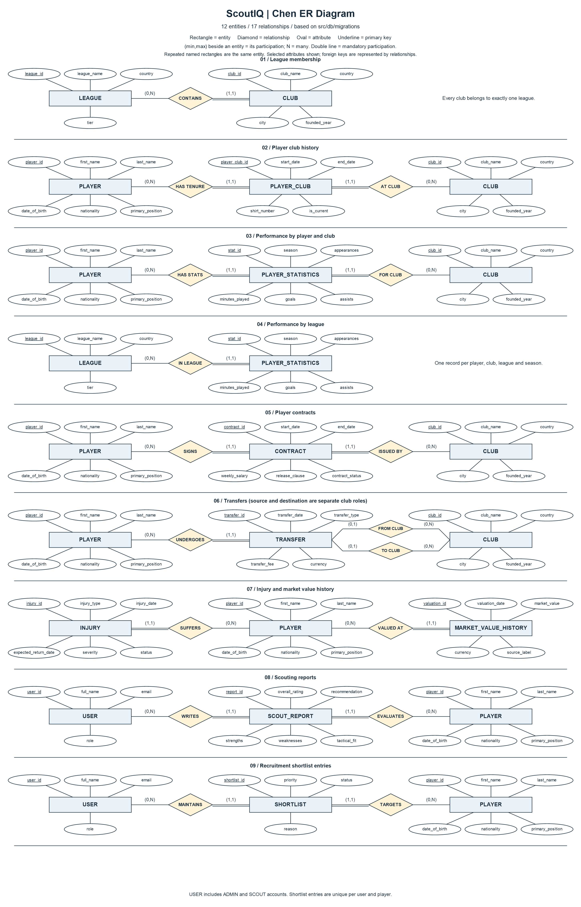

# ScoutIQ ER diagram in Chen notation



Open [the SVG](ER_DIAGRAM_CHEN.svg) to zoom or edit the diagram.

The diagram follows the 12 application entities and all 17 foreign-key relationships declared in `src/db/migrations/001` through `009`, with later attribute additions considered. It is arranged in nine connected subject areas for readability. Repeated rectangles with the same name denote the same entity, not additional tables.

Rectangles represent entities, diamonds represent relationships, ovals represent selected attributes, and underlined attributes identify primary keys. Each `(min,max)` label states how many relationship instances the adjacent entity instance may participate in. `N` means many. Double lines indicate total participation, consistent with required foreign keys; single lines permit zero participation.

Transfer has independent FROM CLUB and TO CLUB relationships. A transfer may reference zero or one club in each role because both foreign keys are nullable. Each transfer must reference exactly one player. A player or club can participate in many transfers.

History and association records retain their own identities: PLAYER_CLUB, PLAYER_STATISTICS, CONTRACT, TRANSFER, SCOUT_REPORT and SHORTLIST are entities with primary keys. Foreign keys are represented by relationships rather than repeated attribute ovals. These are regular entities, not weak entities: each has its own independent primary key.

This diagram displays selected business attributes to keep the relationship structure readable. See [the full relational schema](RELATIONAL_SCHEMA.md) for every column, composite unique key and referential action. Audit timestamps, image URLs, credentials and some detailed statistics/text attributes are omitted. Derived views, Qdrant vectors and migration bookkeeping are outside the application entity model.

Regenerate the PNG and SVG with:

```powershell
powershell -NoProfile -File scripts/draw-chen-er.ps1
```
