# ScoutIQ Football Scouting and Recruitment Intelligence Platform

DBMS Project Report

PES University | Department of Computer Science and Engineering

Database Management Systems | Experiential Learning Level 3 | August to December 2026

### 1 Title

ScoutIQ - Football Scouting and Recruitment Intelligence Platform

### 2 Students SRN and Name

| Student name | SRN |
| --- | --- |
| Ujwal Sanikam | PES1UG24CS506 |
| Ved Mudkavi | PES1UG24CS522 |

GitHub repository: https://github.com/UjwalSanikam/DBMS_PROJECT

Review date: 18 November 2026. The GitHub repository was verified as public and accessible on the review date.

### 3 Abstract

ScoutIQ brings football recruitment records into a single database-driven application. Scouts can search players, examine seasonal performance and injury history, compare candidates, maintain shortlists, and review scouting assessments. Administrators manage application users. MySQL stores the relational records and supports constraints, joins, views, triggers, stored procedures, and transactional workflows. Qdrant provides a derived index of ten-dimensional player statistics for cosine similarity retrieval. Next.js integrates the interface and server-side APIs with both databases.

The completed local demo integrates MySQL and Qdrant. All 52 integration checks pass, including role restrictions, constraints, transactional rollback and vector retrieval, update and deletion. The default production build uses webpack and passes. Section 9 maps the implementation and executed evidence to the supplied 50-mark rubric. The live viva and assessment of originality remain part of the evaluation.


---

## 4 Tech Stack

| Layer | Technology and purpose |
| --- | --- |
| Interface | Next.js 16.3.3 App Router, React 19.2.8, TypeScript 5 and Tailwind CSS 4 |
| Backend | Next.js Route Handlers; server modules for sessions, queries and player details |
| Relational database | MySQL 8.0.46 verified locally; mysql2 ^3.24.2 client |
| Vector database | Qdrant; @qdrant/js-client-rest ^1.20.0; player_profiles collection |
| Authentication | bcryptjs ^3.0.3 password hashing; jose ^6.2.10 signed JWT cookies |
| Validation and tooling | Zod ^4.4.3; ESLint 9; tsx; dotenv; CSV import tools |

### Database choice and architecture

MySQL fits connected player, club, league, contract and scouting data. Foreign keys preserve relationships, while transactional procedures keep transfer and recommendation updates atomic. Qdrant supports nearest-neighbor retrieval across playing-style features. It is a rebuildable search index; MySQL is the authoritative record store.

```text
Browser UI -> Next.js pages and Route Handlers
                    | session and input validation
                    +-> MySQL relational records and SQL analytics
                    +-> Qdrant player_profiles similarity index
```

### Relational design

The schema contains 12 domain tables and a schema_migrations ledger. League and club describe the competition structure; player_club records membership history. Statistics, injuries, contracts, transfers, valuations, reports and shortlist entries reference players. Scout reports and shortlists also reference user accounts.

```text
league 1 -- N club
player 1 -- N player_club N -- 1 club
player 1 -- N player_statistics N -- 1 club / league
player 1 -- N injury / contract / transfer / market_value_history
player 1 -- N scout_report N -- 1 user
player 1 -- N shortlist    N -- 1 user
```

Keys and constraints: each domain table has a primary key; child records use foreign keys. Email, seasonal statistics, dated valuations and per-scout shortlist membership have unique constraints. CHECK constraints validate numerical ranges and dates. A complete ER diagram is maintained in docs/ER_DIAGRAM.md and the relation definitions in docs/RELATIONAL_SCHEMA.md.


---

## 4 Entity Relationship Diagram

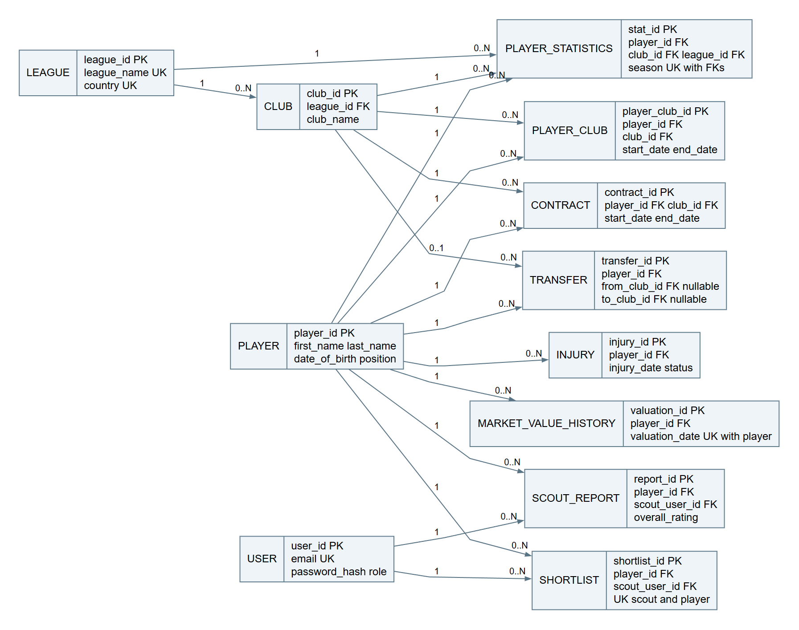

Each arrow connects a parent to zero or more child records. Club references in transfer may be null; from_club_id and to_club_id are separate references. UK labels may form a composite key. The complete relation definitions and referential actions are supplied in docs/RELATIONAL_SCHEMA.md. The migrations are the executable design.

Normalization separates identity from season and historical records. Derived age, latest valuation, availability and rank are computed in queries or views rather than stored redundantly. The Qdrant player ID is an application reference, not a cross-database foreign key.


---

## 5 SQL Database Commands

The canonical setup uses src/db/migrations, applied in filename order by src/scripts/migrate.ts. Nineteen migrations are recorded in the current database. The examples below are source excerpts or executable demonstration templates; parameter values must be supplied for the local demo.

### Database creation and migrations

```sql
CREATE DATABASE IF NOT EXISTS scoutiq
  CHARACTER SET utf8mb4 COLLATE utf8mb4_general_ci;
USE scoutiq;
-- From the terminal: npm run db:migrate
```

### DDL with keys and integrity constraints

```sql
CREATE TABLE IF NOT EXISTS market_value_history (
  valuation_id INT UNSIGNED AUTO_INCREMENT PRIMARY KEY,
  player_id INT UNSIGNED NOT NULL,
  valuation_date DATE NOT NULL,
  market_value DECIMAL(14,2) NOT NULL,
  currency CHAR(3) NOT NULL DEFAULT 'EUR',
  source_label VARCHAR(80) NULL,
  created_at TIMESTAMP NOT NULL DEFAULT CURRENT_TIMESTAMP,
  CONSTRAINT fk_valuation_player FOREIGN KEY (player_id)
    REFERENCES player(player_id) ON DELETE CASCADE,
  CONSTRAINT uq_valuation_player_date UNIQUE (player_id, valuation_date),
  CONSTRAINT chk_valuation_value CHECK (market_value >= 0)
) ENGINE=InnoDB DEFAULT CHARSET=utf8mb4;
```

This shortened table definition illustrates migration 007. The executable migration remains the authoritative source.

```sql
CREATE INDEX idx_stats_player_season
  ON player_statistics (player_id, season);
-- Migration 016 also adds photo and crest URL columns.
-- Migration 017 retires a trigger that modified its own table:
DROP TRIGGER IF EXISTS trg_contract_single_active_after_insert;
```

### Inspect implemented objects

```sql
SHOW FULL TABLES WHERE Table_type = 'VIEW';
SHOW TRIGGERS;
SHOW PROCEDURE STATUS WHERE Db = 'scoutiq';
SHOW EVENTS FROM scoutiq;
SHOW INDEX FROM player_statistics;
SHOW VARIABLES LIKE 'event_scheduler';
```

Observed: six views, four validation triggers, two procedures and ev_expire_contracts enabled with event_scheduler ON. Fresh-database creation and a repeat migration run both passed.


---

## 5 SQL Operations and Advanced Queries

### DML operations

Shortlist creation, update and deletion use parameterized SQL and the authenticated scout ID. The following are demonstration templates matching the application workflow, with ? values bound by mysql2.

```sql
INSERT INTO shortlist
  (scout_user_id, player_id, priority, status, reason)
VALUES (?, ?, 'HIGH', 'RECOMMENDED', ?);

SELECT * FROM shortlist WHERE scout_user_id = ?;

UPDATE shortlist SET priority = ?, status = ?, reason = ?
WHERE shortlist_id = ? AND scout_user_id = ?;

DELETE FROM shortlist
WHERE shortlist_id = ? AND scout_user_id = ?;
```

### Join and nested aggregate query

```sql
SELECT mvh.player_id, mvh.market_value, mvh.valuation_date
FROM market_value_history mvh
INNER JOIN (
  SELECT player_id, MAX(valuation_date) AS max_date
  FROM market_value_history GROUP BY player_id
) latest ON latest.player_id = mvh.player_id
        AND latest.max_date = mvh.valuation_date;
```

### Correlated query

```sql
SELECT p.player_id, p.first_name, p.last_name
FROM player p
WHERE NOT EXISTS (
  SELECT 1 FROM injury i WHERE i.player_id = p.player_id
  AND i.status IN ('ACTIVE', 'RECOVERING')
);
```

### Advanced database concepts

sp_record_transfer inserts the transfer, closes the current membership and opens the destination membership inside START TRANSACTION and COMMIT. An SQL exception handler executes ROLLBACK and RESIGNAL. sp_add_scout_recommendation inserts a report and conditionally upserts its shortlist entry atomically. Insert and update triggers validate injury dates and contract dates and amounts. Six views support recruitment analysis; an event expires past contracts daily.

Migration 019 adds vw_ranked_scout_targets with a report_scores CTE and DENSE_RANK window function. The dashboard uses the resulting ranking. Both stored procedures passed deliberate mid-operation failure and rollback tests. Invalid dates, ranges, duplicate keys and foreign-key violations were rejected in the executed test suite.


---

## 6 NoSQL and Vector Database Commands

### Player vector model

The vector builder selects season 2025-2026 records with at least 450 minutes. Seventy-one players currently qualify in the reviewed local demo. It computes goals, assists, xG, xA, shots, key passes, progressive passes, tackles and interceptions per 90 minutes, plus pass accuracy. Each feature is standardized across the eligible pool as (value - mean) / standard deviation; a zero-variance feature becomes zero.

Each Qdrant point uses the MySQL player ID and contains a ten-value vector plus player name, position, club and season payload. Cosine similarity ranks neighbors; same-position filtering is optional and the target is removed from the results. Displayed similarity rescales cosine scores to 0-100 and is not a calibrated probability.

### Implemented collection creation and point upsert

```typescript
await client.createCollection('player_profiles', {
  vectors: { size: 10, distance: 'Cosine' }
});
await client.upsert('player_profiles', { points });
```

### Implemented retrieval and nearest-neighbor query

```typescript
const points = await client.retrieve('player_profiles', {
  ids: [playerId], with_vector: true, with_payload: true
});
const result = await client.query('player_profiles', {
  query: target.vector as number[],
  limit: limit + 1, filter, with_payload: true
});
```

```typescript
await client.delete('player_profiles', {
  wait: true, points: [playerId]
});
```

### Setup and execution

```bash
npm run services:start
# Windows local services: MySQL 3307 and Qdrant 6333.
npm run rebuild-vectors
# Open a profile, find similar players, then test Admin delete/refresh.
```

Upsert inserts new points or overwrites existing IDs. Administrators can delete a player vector using DELETE /api/players/[id]/vector, then refresh the index using POST /api/admin/vectors. Rebuilds aggregate each player across clubs, upsert the eligible IDs and delete obsolete stored IDs. Both administrator actions are available on the player profile. Tests verify deletion, restoration, stale cleanup and multi-club aggregation.

Runtime verification on 18 November 2026: Qdrant 1.20.2 responds locally. The player_profiles collection uses size 10 and Cosine distance. Similar-player and same-position requests pass; the target is excluded. Below-threshold or deleted targets return 404, and malformed limits return 400. Rebuilding restores eligible deleted points.


---

## 7 Next.js Project Tree Structure

```text
DBMS_PROJECT/
|-- package.json / package-lock.json / next.config.ts
|-- .env.example
|-- scripts/                         report and startup tools
|-- public/images/player-portraits.png
|-- data-import/                     CSV import inputs
|-- docs/                            design and demo documentation
|-- src/
|   |-- proxy.ts                     page authentication and roles
|   |-- app/
|   |   |-- layout.tsx / globals.css / page.tsx
|   |   |-- login/                   sign-in page and form
|   |   |-- (app)/
|   |   |   |-- layout.tsx / app-nav.tsx / logout-button.tsx
|   |   |   |-- dashboard/page.tsx
|   |   |   |-- players/page.tsx / players-table.tsx
|   |   |   |-- players/[id]/         profile and similarity UI
|   |   |   |-- compare/page.tsx
|   |   |   |-- shortlist/page.tsx / reports/page.tsx
|   |   |   `-- admin/users/          account administration
|   |   `-- api/
|   |       |-- auth/login / logout / me
|   |       |-- admin/users / admin/vectors / dashboard / reports
|   |       |-- players/route.ts / players/compare/route.ts
|   |       |-- players/[id]/route.ts
|   |       |-- players/[id]/contracts / injuries / reports
|   |       |-- players/[id]/similar / vector / transfers / valuations
|   |       `-- shortlist/route.ts / shortlist/[id]/route.ts
|   |-- components/                  brand and player avatar
|   |-- lib/
|   |   |-- auth.ts / session.ts / db.ts / qdrant.ts
|   |   `-- dashboard.ts / player-detail.ts / similarity.ts / vector-index.ts
|   |-- db/migrations/               001 through 019 SQL files
|   `-- scripts/
|       |-- migrate.ts / seed-admin.ts / seed-football.ts
|       |-- seed-recruitment.ts / import-transfermarkt.ts
|       |-- setup-local.ts / provision-database.ts / test-integration.ts
|       `-- rebuild-vectors.ts
`-- output/                          generated submission report
```

The tree condenses repeated route.ts leaves for readability. Database access is server-side. Page protection is in src/proxy.ts; APIs independently call requireSession and validate inputs. Migrations under src/db/migrations are canonical. Root SQL dumps and the separate db/migrations copy are reference artifacts and must not replace the documented migration path.


---

## 8 Sample Screenshots of Application and Code

The following application captures were taken from the local webpack development server on 18 November 2026 using the configured demonstration account. They show the current MySQL-backed demo.

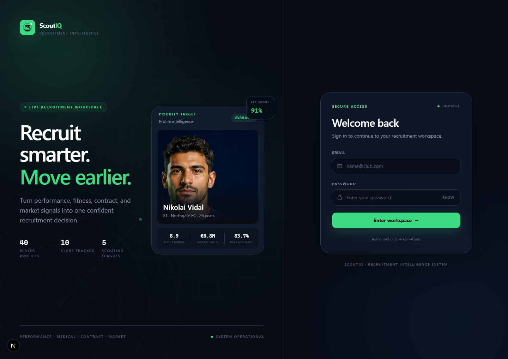

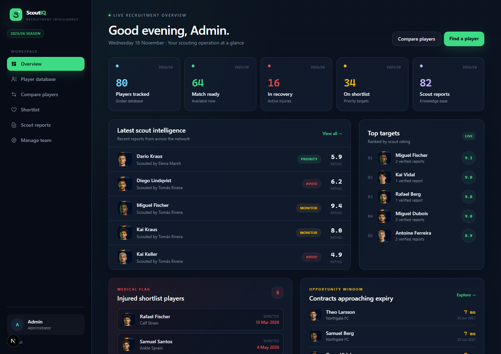


---

## 8 Player Search and Detail Screenshots

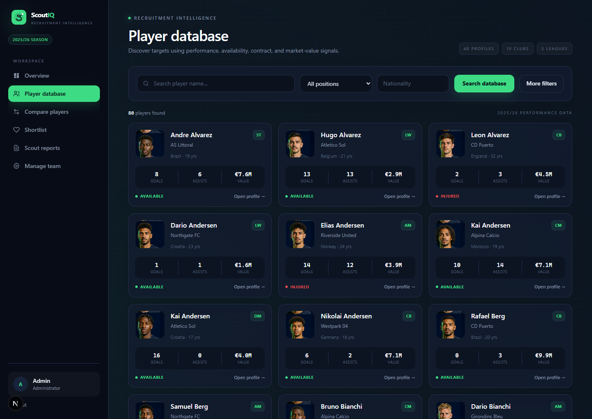

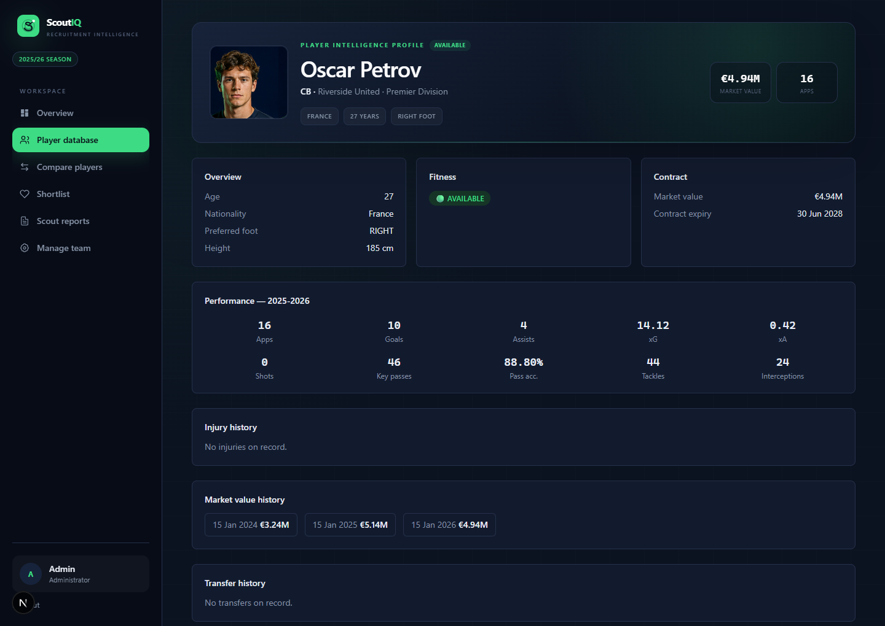


---

## 8 Comparison and Vector Code Screenshots

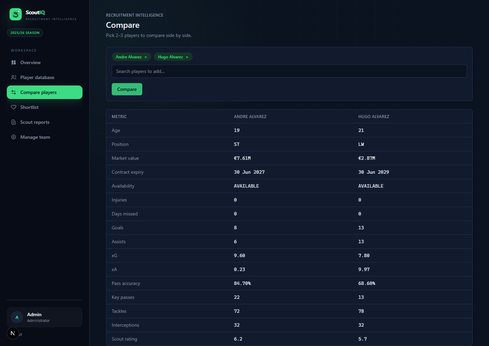

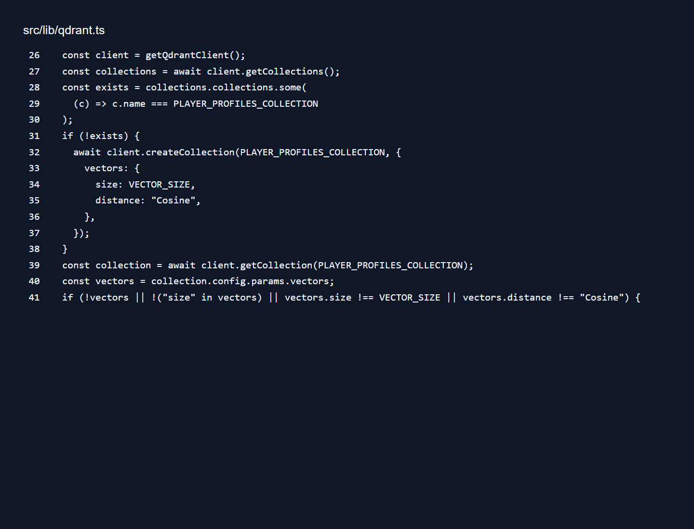

Code screenshots render the actual source excerpt with line numbers. Live vector results and delete controls are shown on the following page.


---

## 8 Live Vector Demonstration

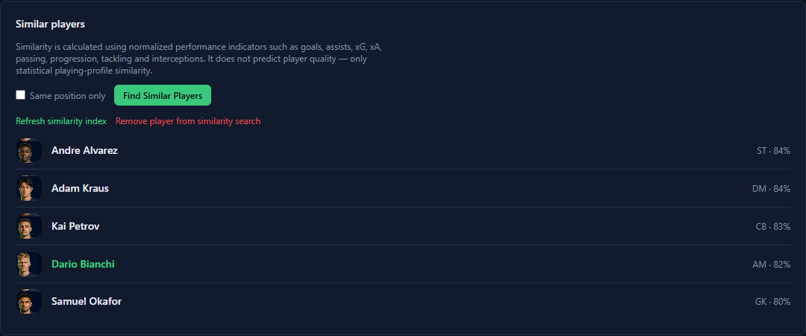

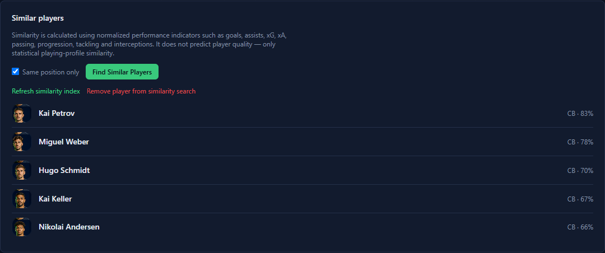

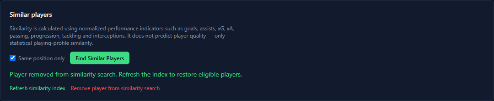

The vector deletion and restore flow was executed successfully. The automated suite also checks that retrieval returns 404 after deletion and succeeds again after refresh.


---

## 8 SQL Code and Verification Evidence

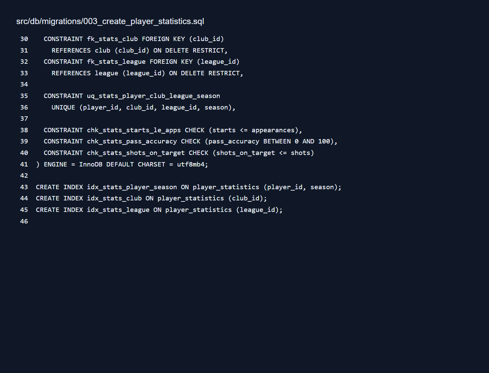

| Executed check | Observed result |
| --- | --- |
| npm run lint | PASS - exit code 0 |
| npx tsc --noEmit | PASS - exit code 0 |
| npm run build | PASS - webpack is now the default build configuration |
| npx next build --webpack | PASS - optimized build and route generation completed |
| MySQL read-only inspection | PASS - 13 tables including ledger; 6 views; 4 triggers; 2 procedures; event enabled |
| Authentication and APIs | PASS - anonymous player API 401; invalid login 401; admin login 200; comparison API 200 |
| Browser demo | PASS - login, dashboard, player search, detail and two-player comparison observed |
| Qdrant connectivity | PASS - collection, size 10, Cosine metric and live retrieval verified |

The integration harness passes 52 of 52 checks. It verifies fresh/repeated migrations, role-denial tests, SQL and API writes, invalid inputs, ownership restrictions, deliberate mid-operation rollback, vector retrieval/deletion/restoration, stale cleanup and multi-club statistics. Disposable fixtures and the temporary verification schema are removed in cleanup. Complete results are in docs/TESTING.md and docs/evidence/integration-results.json.


---

## 9 Evaluation Rubrics Completion Status

The supplied DBMS Level 3 PDF assigns 50 marks across the following 14 components. Status describes implementation and observed evidence; it is not an awarded or predicted mark. Parenthetical concept lists in the rubric may need instructor interpretation.

| No | Evaluation component | Max | Completion and evidence |
| --- | --- | --- | --- |
| 1 | ER diagram | 2 | Documented - Rendered ER diagram included; editable SVG, DOT and detailed Mermaid source supplied. |
| 2 | Relational schema with keys, relationships and constraints | 3 | Documented - Schema, keys, referential actions and constraints documented; live negative tests passed. |
| 3 | SQL DDL with constraints | 4 | Implemented - 19 migrations apply on a fresh schema and skip on repeat. Constraints verified. |
| 4 | NoSQL or vector database creation | 4 | Verified - Live Qdrant collection verified with 71 eligible player vectors. |
| 5 | Technology justification | 1 | Documented - MySQL for integrity and transactions; Qdrant for numeric similarity retrieval. |
| 6 | DML operations | 4 | Implemented - API and SQL create/read/update/delete checks pass using disposable fixtures. |
| 7 | Nested or correlated or recursive queries and joins | 4 | Implemented - Joins, nested aggregation and NOT EXISTS present. No recursive query found. |
| 8 | Advanced SQL concepts such as procedure, function, trigger, CTE | 6 | Verified - Two procedures, four triggers, CTE/window ranking, views, indexes and event verified. |
| 9 | NoSQL or vector feature and RUD | 7 | Verified - Retrieve/query/upsert/delete, position filter, stale cleanup and restore all pass. |
| 10 | Next.js interface | 3 | Observed - Working login, dashboard, player pages and comparison screenshots. |
| 11 | Backend or API database integration | 2 | Verified - MySQL and Qdrant APIs both execute successfully; browser demo captured. |
| 12 | Authentication and minimum two roles with database RBAC | 4 | Verified - ADMIN/SCOUT sessions plus separate MySQL ADMIN/SCOUT/AUTH roles. Denied operations tested. |
| 13 | Documentation and Git or GitHub | 2 | Documented - Report, diagram, screenshots, executed tests and public GitHub link supplied. |
| 14 | Originality, individual contribution, modification and viva | 4 | Team evidence needed - Requested 50/50 responsibility allocation documented. Live modification and viva remain student tasks. |

Total maximum marks: 50. A precise score requires the evaluator to assess correct execution and the viva.


---

## 9 Submission Readiness and Team Allocation

### Technical readiness

The technical deliverables are prepared: the Next.js application, relational and vector databases, restricted runtime accounts, advanced SQL, migration scripts, setup tooling, executed test evidence, screenshots and this report. The default build passes; all 52 integration checks pass. A clean npm installation and production build are checked separately.

Local setup uses an isolated MySQL 8.0.46 process on port 3307 and Qdrant 1.20.2 on port 6333. Existing MySQL data on port 3306 is preserved. Start the prepared services with npm run services:start, then launch npm run dev. On another Windows machine with MySQL installed, run npm ci followed by npm run setup:local. Manual setup is documented for other platforms.

### Equal responsibility allocation

| Student and SRN | Allocated responsibility |
| --- | --- |
| Ujwal Sanikam PES1UG24CS506 | 50% - relational design, migrations, advanced SQL, integrity constraints, transactional workflows and database access |
| Ved Mudkavi PES1UG24CS522 | 50% - Next.js interface, API integration, vector workflows, test execution and report assembly |

This is the team requested responsibility allocation. It is not an independently verified history of authorship. Both students should be able to explain and modify their assigned parts during evaluation.

### Final student actions

Rehearse the live demo using docs/DEMO_GUIDE.md. Confirm the title is unique within the section and be ready to explain original design decisions, the equal allocation and any assistance used. Check the submitted GitHub revision matches the source package. These human assessment steps cannot be completed by an automated test or assigned an automatic mark.

### Submission topic coverage

All nine requested topics are included: title; student SRNs and names; abstract; tech stack; SQL commands; vector commands; Next.js tree; application and code screenshots; and evaluation rubric completion. The supplied rubric has 14 components totaling 50 marks. Implementation evidence is separate from the evaluator's awarded score.

### References

DBMS Level 3.pdf, page 1, evaluation tables. Canonical source: src/db/migrations/001-019; src/lib/db.ts, qdrant.ts, vector-index.ts and similarity.ts; src/scripts/provision-database.ts, setup-local.ts and test-integration.ts; src/app/api. Evidence: docs/TESTING.md and docs/evidence/integration-results.json. Official vector API reference: https://qdrant.tech/documentation/manage-data/points/. Public repository: https://github.com/UjwalSanikam/DBMS_PROJECT.
